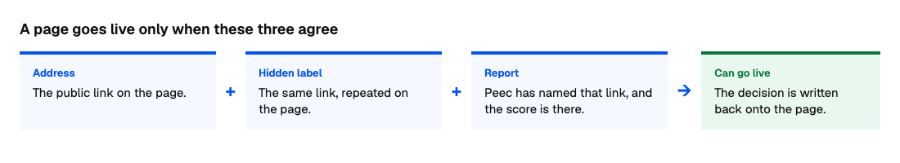
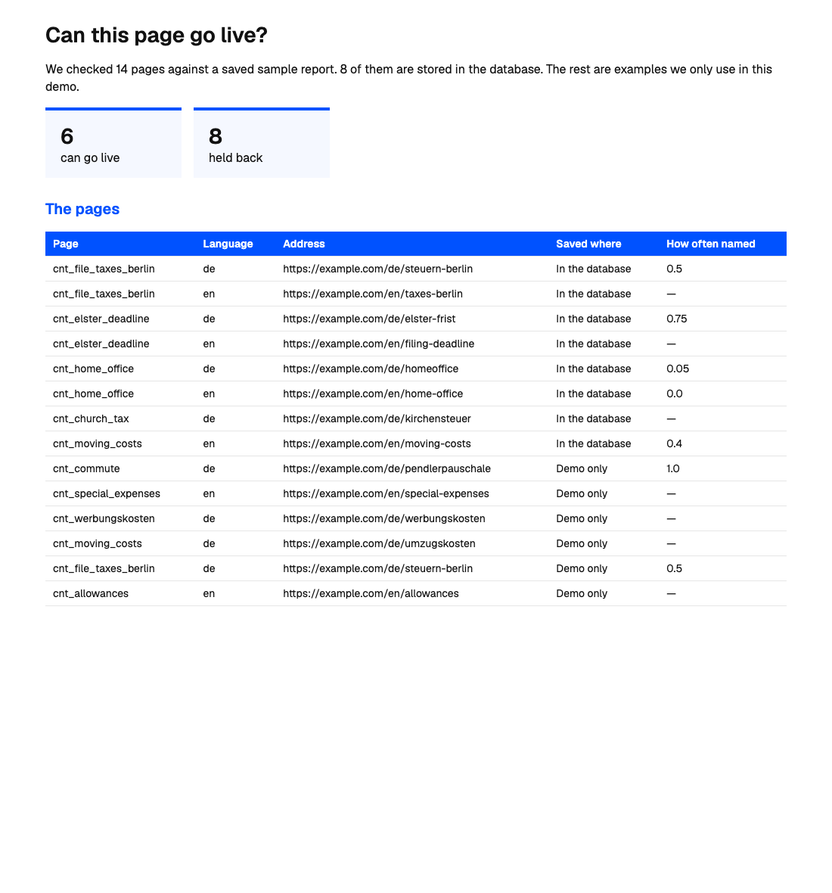
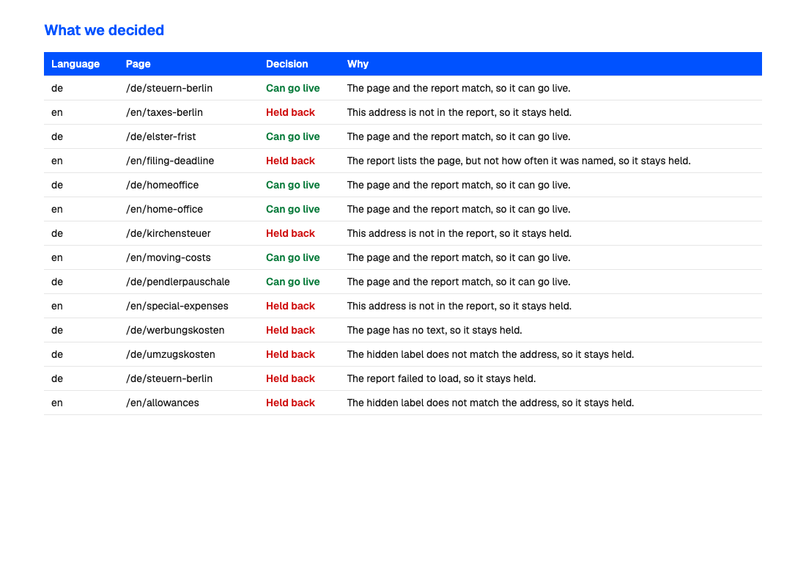

# Content gate

A page goes live only when three things agree: its public address, a hidden label on the page that repeats that address, and a row for that address in a naming report. The report comes from Peec, or from a saved sample when you run this offline. The page itself cannot tell you whether an answer engine named it. The check writes the decision back onto the page: **can go live**, or **held back**, with the reason.

This repo is the rule, and the optional database that stores it. The runner that fetches a page, decides, and appends an audit log is [publish-loop](https://github.com/seancmry/publish-loop).

Someone publishing a page uses this when "go live" has to be a check. In the sample, the German page is in the report, so it can go live. The English page is not, so it is held.



## Run the check

```bash
python3 -m venv .venv
source .venv/bin/activate
pip install -r requirements.txt
python gate.py --locale de
python gate.py --locale en
```

Both decisions land in `content/page.json`.

**Fourteen pages, no API calls:**

```bash
python experiments.py
```

Six can go live. Eight are held on purpose. Pictures and a short note: [docs/content-gate-lab.pdf](docs/content-gate-lab.pdf).





### Live Peec report

Copy `.env.example` to `.env`, add your Peec key, then:

```bash
python gate.py --locale de --live
```

Docs: https://docs.peec.ai/api-reference/reports/get-urls-report

### Supabase

After a Supabase project exists:

```bash
npm run keys
```

That saves the project address and key into `.env`. The file is not committed.

## Inputs

| Input | What the check does with it |
| --- | --- |
| Address | Match key between the page and the report. |
| Hidden label (`json_ld.url`) | Must equal the address. A mismatch holds the page. |
| Page text | Empty text holds the page. |
| How often named | Named divided by found. A low number still allows the page. A missing number holds it. |
| `--locale` | `de` or `en`. Default is German. An unknown language stops the script. |
| `--live` | Call Peec. Needs `PEEC_API_KEY` in `.env`. With no key, the page is held and the error is saved. |
| `fixtures/peec-urls.json` | Saved report for the offline run. |
| `content/page.json` | The page `gate.py` checks, and where it writes the decision. |

Field names and the database function are in `VARIABLE_SCHEMA.md`.

## Database

Eight pages live in a `pages` table on a free Supabase project (Frankfurt). The database stores pages. It does not invent the report. Numbers still come from the saved sample, or from a Peec key later.

`published`, `blocked`, `block_reason`, and `last_peec` are written back onto those rows. Extra `articles` and `checks` views include dummy rows (`saved_where = Dummy`) so the table is easier to read. The SQL function `apply_check` is in `supabase/apply_check.sql`. It is the same rule, stored next to the rows. It does not call Peec.
